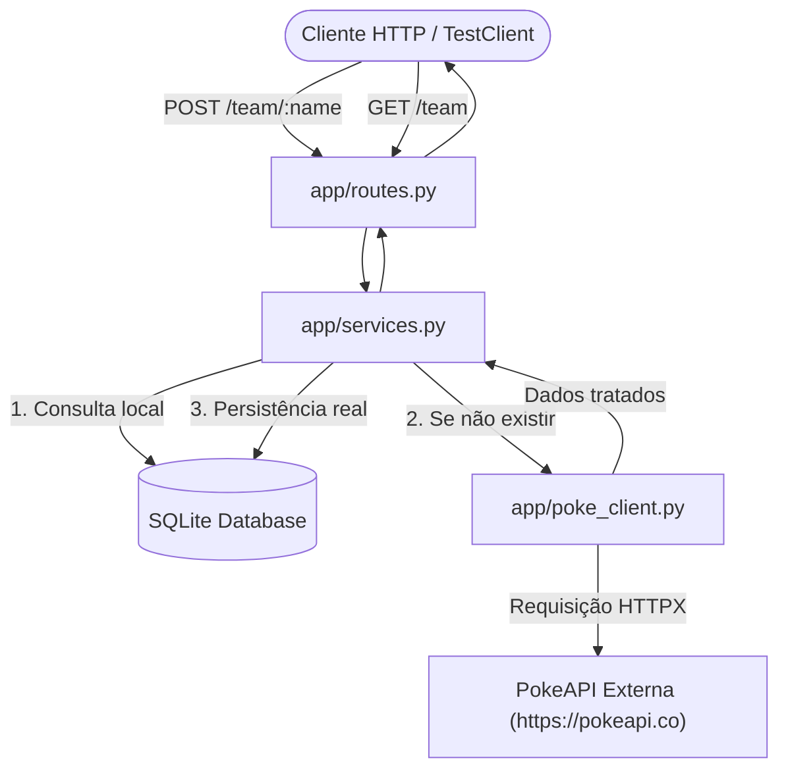

# 🐾 Pokemon Team Manager API

API REST moderna desenvolvida em **FastAPI**, **SQLAlchemy** e **HTTPX**, projetada com foco em arquitetura em camadas e uma suíte rigorosa de **testes de integração ponta a ponta** com **Pytest** e **RESPX**.

A aplicação gerencia uma equipe Pokémon, integrando-se de forma resiliente com a [PokeAPI](https://pokeapi.co/) externa e persistindo os dados em banco de dados local **SQLite**.

---

## 🏗️ 1. Arquitetura da Aplicação e Estrutura do Projeto

O projeto segue a separação de responsabilidades em camadas limpas e desacopladas:

```
ava/
├── app/
│   ├── __init__.py          # Inicialização do pacote app
│   ├── main.py              # Ponto de entrada FastAPI, lifespan e rotas
│   ├── database.py          # Configuração do SQLAlchemy e sessão SQLite
│   ├── models.py            # Entidades do banco de dados (tabela 'pokemons')
│   ├── schemas.py           # Modelos Pydantic (validação e contratos de I/O)
│   ├── services.py          # Regras de negócio e orquestração do domínio
│   ├── poke_client.py       # Cliente HTTPX com resiliência para a PokeAPI
│   └── routes.py            # Endpoints da API REST (/team)
├── tests/
│   ├── __init__.py          # Pacote de testes
│   ├── conftest.py          # Fixtures do Pytest: SQLite em memória e TestClient
│   └── integration/
│       ├── __init__.py
│       └── test_pokemon_api.py # Suíte de testes de integração (AAA)
├── .gitignore               # Arquivos ignorados pelo controle de versão
├── pytest.ini               # Configurações de execução do Pytest
├── requirements.txt         # Dependências do projeto
└── README.md                # Documentação técnica e guia de execução
```

### 🔄 Fluxo de Integração e Fronteiras de Sistema



---

## 🧪 2. Cenário de Integração e Estratégia de Testes

### 🎯 Princípio Fundamental: Exercitar a Pilha Real
Nesta suíte de testes de integração:
* **PROIBIDO**: Não são realizados mocks das camadas internas (`Routes`, `Service`, `Database` ou `ORM`). O teste trafega pela pilha completa da aplicação FastAPI.
* **MOCK RESTRITO À FRONTEIRA**: O mock é aplicado **exclusivamente na borda externa de I/O de rede** (a chamada HTTPX para a PokeAPI externa) através da biblioteca `respx`.
* **Banco SQLite Isolado**: Cada teste executa sobre um banco SQLite isolado em memória (`sqlite:///:memory:`) utilizando `StaticPool`. A fixture garante que o esquema seja recriado e descartado a cada execução, evitando qualquer efeito colateral entre testes.

### 📐 Padrão AAA (Arrange, Act, Assert) e Assert Duplo
Todos os casos de teste seguem formalmente o padrão AAA:
1. **Arrange (Preparação)**: Configura o estado inicial do banco de dados e intercepta as respostas esperadas ou falhas da PokeAPI via `respx`.
2. **Act (Execução)**: Dispara a requisição HTTP real através do `TestClient` da FastAPI.
3. **Assert (Verificação)**:
   - Valida código de status HTTP e schema JSON de retorno.
   - **Assert Duplo**: Verifica se o registro foi efetivamente persistido no banco de dados via ORM direto (`db_session.query(...)`) e por meio do endpoint de leitura (`GET /team`).

---

## 🤖 3. Tipos de Prompts Utilizados para Gerar os Testes

Para conceber e estruturar a suíte de testes de integração com alto padrão de qualidade, foram empregadas técnicas consagradas de **Engenharia de Prompt**:

### 1. Role Prompting (Atribuição de Papel Especialista)
> **Definição:** Estabelece a persona do modelo antes de fornecer as tarefas técnicas.
* **Aplicação no Projeto:** O prompt instrui a IA a atuar conjuntamente como um *Engenheiro de Software Sênior* e *Especialista em QA*. Isso orienta o modelo a não apenas criar testes superficiais, mas a priorizar contratos HTTP, resiliência a falhas de terceiros, idempotência e isolamento transacional de banco de dados.

### 2. Constraint-Based Prompting / Negative Constraints (Prompting por Restrições Estritas)
> **Definição:** Define regras explícitas do que **NÃO** deve ser feito para evitar antipadrões comuns de LLMs.
* **Aplicação no Projeto:**
  * *Restrição Negativa:* "PROIBIDO: Não faça mock das camadas internas (Routes, Service, Database)."
  * *Fronteira Permitida:* "MOCK PERMITIDO: Faça mock APENAS da fronteira HTTP externa usando respx/monkeypatch."
  * Isso impede que o agente produza mocks fáceis em funções de serviço (`mocker.patch('app.services...')`), forçando a execução da pilha real da aplicação.

### 3. Specification-Driven Prompting (Prompting Orientado a Especificação e Casos de Borda)
> **Definição:** Detalha os critérios de aceitação e particiona os testes em domínios lógicos (Happy Path vs. Edge Cases).
* **Aplicação no Projeto:** Fornecimento explícito dos cenários requeridos:
  * *Caminho Feliz:* `POST /team/{name}` com validação 201/200, Assert Duplo e `GET /team`.
  * *Cenário de Negócio Inexistente:* Simulação de HTTP 404 da PokeAPI refletida em 404 amigável da nossa API.
  * *Falhas de Infraestrutura:* Simulação de Timeout e HTTP 500 externo com retorno em HTTP 502 (Bad Gateway), verificando que a aplicação não sofre *crash*.
  * *Contrato e Validação:* Teste de HTTP 422 para parâmetros fora da tipagem/regras de validação do Pydantic/FastAPI.

### 4. Few-Shot / Structural Formatting Prompting (Prompting de Estrutura Declarativa)
> **Definição:** Orienta a forma como o código gerado deve ser organizado e anotado no repositório.
* **Aplicação no Projeto:** Exigência explícita do padrão **AAA (Arrange, Act, Assert)** com divisões visuais nos testes, garantindo legibilidade para auditoria de QA e manutenção contínua.

### 5. Chain-of-Thought (CoT) Prompting (Raciocínio Passo a Passo)
> **Definição:** Conduz o modelo a planejar em etapas sequenciais (Setup de ambiente -> Implementação de Domínio -> Configuração de Fixtures -> Implementação de Testes -> Documentação).
* **Aplicação no Projeto:** Garantiu que o banco e os schemas estivessem consolidados antes de escrever os testes, eliminando discrepâncias de tipos ou imports circulares.

---

## 📊 4. Cenários de Teste Implementados

| Cenário | Endpoint | Status HTTP | Comportamento Avaliado | Tipo de Asserção |
| :--- | :--- | :--- | :--- | :--- |
| **1.1 Happy Path** | `POST /team/pikachu` | `201 Created` | Busca na PokeAPI, persiste no SQLite e retorna dados completos | Assert Duplo (ORM + `GET /team`) |
| **1.2 Idempotência** | `POST /team/charizard` | `200 OK` | Pokémon já cadastrado: retorna do banco sem acionar a PokeAPI | Validação de banco e ausência de chamada HTTP externa |
| **1.3 Listagem** | `GET /team` | `200 OK` | Recupera todos os Pokémons previamente salvos na equipe | Lista com ordenação e atributos validados |
| **2.1 404 Negócio** | `POST /team/inexistente`| `404 Not Found` | Pokémon inexistente na PokeAPI; retorna erro e não altera o banco | Mensagem descritiva e contagem de banco inalterada |
| **2.2 Falha Externa** | `POST /team/mewtwo` | `502 Bad Gateway` | PokeAPI retorna 500; API trata erro sem quebrar o processo | Tratamento resiliente e estabilidade do serviço |
| **2.3 Timeout** | `POST /team/gengar` | `502 Bad Gateway` | Timeout de rede na conexão externa; API retorna 502 amigável | Captura de `httpx.TimeoutException` |
| **2.4 Validação Query**| `GET /team?limit=erro` | `422 Unprocessable`| Parâmetro fora da tipagem (`limit` não numérico) | Contrato FastAPI/Pydantic |
| **2.5 Validação Path** | `POST /team/!@#$%` | `422 Unprocessable`| Nome com caracteres proibidos no padrão regex | Rejeição por validação de entrada |

---

## 🚀 5. Como Executar o Projeto

### Pré-requisitos
* Python 3.10 ou superior instalado.
* Git instalado.

### Passo 1: Clonar e Acessar o Repositório
```bash
cd ava
```

### Passo 2: Criar e Ativar o Ambiente Virtual
* No **macOS / Linux**:
  ```bash
  python3 -m venv .venv
  source .venv/bin/activate
  ```
* No **Windows (PowerShell)**:
  ```powershell
  python -m venv .venv
  .venv\Scripts\Activate.ps1
  ```

### Passo 3: Instalar as Dependências
```bash
pip install --upgrade pip
pip install -r requirements.txt
```

### Passo 4: Executar a Suíte de Testes de Integração
Para rodar todos os testes de integração com verbosidade:
```bash
pytest -v
```

Para rodar com relatório detalhado de asserções:
```bash
pytest -v --tb=short
```

### Passo 5: Inicializar o Servidor da Aplicação
Com o ambiente virtual ativado:
```bash
uvicorn app.main:app --reload --port 8000
```

* **Swagger UI interativo:** [http://127.0.0.1:8000/docs](http://127.0.0.1:8000/docs)
* **ReDoc alternativo:** [http://127.0.0.1:8000/redoc](http://127.0.0.1:8000/redoc)
* **Health Check:** [http://127.0.0.1:8000/health](http://127.0.0.1:8000/health)

---

## 🛠️ Exemplos de Uso Manual da API

### Adicionar um Pokémon à equipe
```bash
curl -X POST "http://127.0.0.1:8000/team/pikachu" -H "accept: application/json"
```

### Listar os Pokémons da equipe
```bash
curl -X GET "http://127.0.0.1:8000/team" -H "accept: application/json"
```
